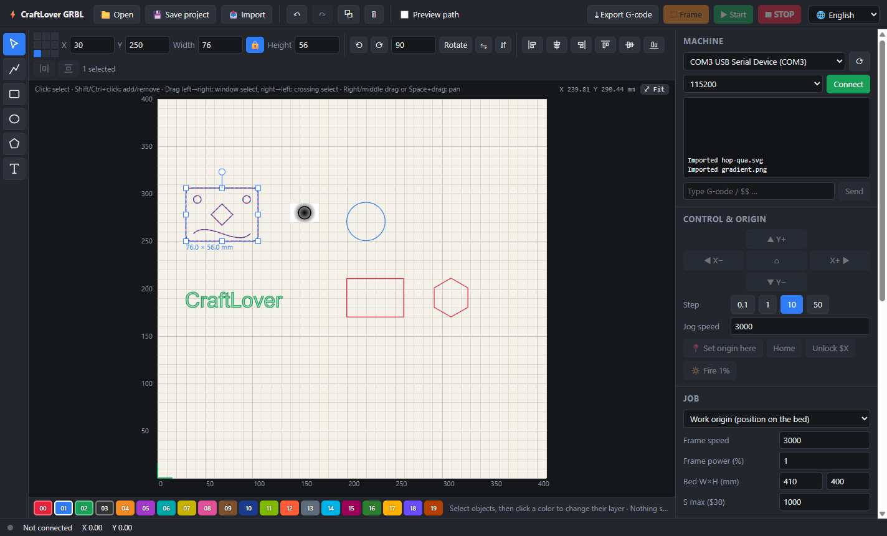
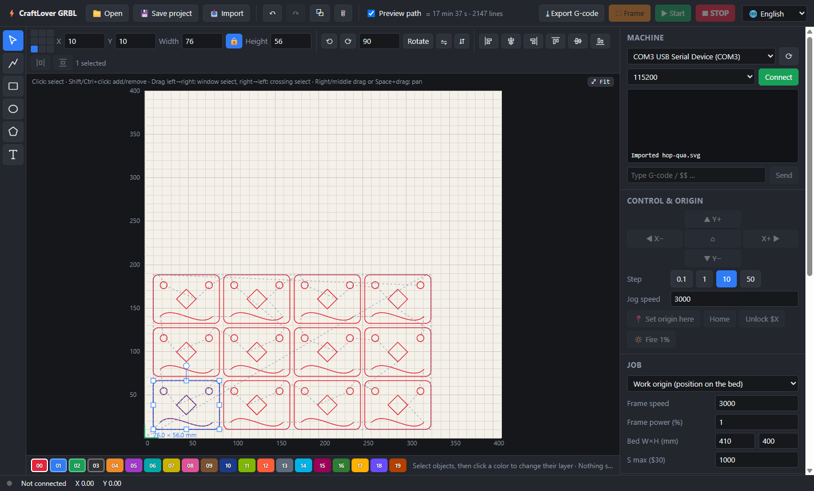

# CraftLover GRBL

**English** · [Tiếng Việt](README.vi.md)

[](LICENSE)


CraftLover GRBL is **free, open-source** software for designing and running jobs on **GRBL 1.1** laser engravers and cutters.
You can draw or import artwork, lay out many parts on the bed, frame the job at low power and stream the G-code, all from one window.
It ships with settings for the **Sculpfun S30 10W** and works with most GRBL-based diode lasers.



---

## Contents

- [Features](#features)
- [Installation](#installation)
- [Quick start](#quick-start)
- [User guide](#user-guide)
- [Keyboard shortcuts](#keyboard-shortcuts)
- [Starting settings for a Sculpfun S30 10W](#starting-settings-for-a-sculpfun-s30-10w)
- [Safety](#safety)
- [Troubleshooting](#troubleshooting)
- [Translations](#translations)
- [For developers](#for-developers)
- [Roadmap](#roadmap)
- [License](#license)

---

## Features

**Built-in designer**
- Draw polylines, rectangles (with rounded corners), ellipses and circles, regular polygons.
- Add text using any font installed on Windows, with full Unicode support.
- Select several objects at once, including by dragging a box around them.
- Move, resize, rotate and flip objects; align them and spread them out evenly.
- Undo / redo, copy / paste and duplicate.
- A color palette where every color is a layer with its own speed and power.

**Import**
- Vector files: SVG, PDF, AI, and EPS (EPS needs Ghostscript).
- Images: JPG, PNG, BMP, GIF, WEBP.
- Image tracing, which turns black-and-white artwork into cut paths.

**Processing**
- Three layer modes:
  - **Line:** cut or score along the outlines.
  - **Fill:** engrave the inside of vector shapes.
  - **Image:** engrave a picture, using Floyd–Steinberg dithering, a black-and-white threshold, or grayscale.
- **Grid copies:** cut many identical parts in one job.
- Optimized cut order: inner shapes are cut before outer outlines, and the nearest path is picked next to reduce travel.
- Toolpath preview with a time estimate. G-code export.

**Machine control**
- Connects over USB (COM port) and shows the machine's state and position live.
- Jog the laser head, set the origin, run homing, unlock alarms, and fire a 1% beam for positioning.
- **Frame:** traces the outline of the job at very low power, so you can check the position without burning the material.
- Run jobs from the work origin, or from the current laser position using one of 9 anchor points.
- Pause, resume, and an emergency **STOP** that switches the laser off immediately.

**Languages:** English (default) and Tiếng Việt. You can switch at any time from the 🌐 menu in the top-right corner.



---

## Installation

There is no packaged `.exe` installer yet. For now you run the app from source, which takes about five minutes.

### Requirements

| Component | Notes |
|---|---|
| Windows 10 / 11 (64-bit) | Font discovery and Ghostscript lookup are Windows-specific. macOS/Linux may work but are untested. |
| [Node.js](https://nodejs.org/) 20 or newer | Use the LTS version. |
| [Git](https://git-scm.com/downloads) | Used to download the source code. |
| USB-serial driver (CH340) | Only needed if Windows does not detect your laser. |
| [Ghostscript](https://ghostscript.com/releases/gsdnld.html), 64-bit | *Optional.* Only needed to open EPS files. |

### Steps

Open PowerShell and run these commands one after another:

```powershell
git clone https://github.com/craft-lover-lab/craftlover-grbl.git
```

```powershell
cd craftlover-grbl
```

```powershell
npm install
```

```powershell
npm start
```

After that, open the `craftlover-grbl` folder and run `npm start` whenever you want to use the app.
To update to the latest version, run `git pull` and then `npm install`.

---

## Quick start

This example cuts a shape from an SVG file on a Sculpfun S30.

1. **Connect:** plug in the USB cable and switch the laser on. In the **Machine** panel, pick the COM port, choose **115200**, and click **Connect**. The status bar should show `Idle`.
2. **Check the firmware** (first time only): type `$$` in the command box and click **Send**. Make sure the output contains:
   - `$32=1`: laser mode, **required**. If it shows another value, send `$32=1`.
   - `$30=1000`: this must match **S max** in the **Job** panel.
3. **Set the origin:** use the arrow buttons to move the laser head to the bottom-left corner of your material, then click **📍 Set origin here**.
4. **Import or draw:** click **📥 Import** and pick an SVG file, or draw with the tools on the left. Drag the object to where you want it.
5. **Layer settings:** open the **Cut** layer in the **Layers** panel and enter speed, power and number of passes. See the [starting settings](#starting-settings-for-a-sculpfun-s30-10w).
6. **Frame:** click **⬚ Frame**. The head traces the job outline with a very weak beam, so you can check that the material is in the right place.
7. **Run:** put on laser safety glasses, close the enclosure if you have one, and click **▶ Start**.

---

## User guide

### Screen layout

| Area | What it does |
|---|---|
| Top toolbar | Open/save project, import, undo/redo, toolpath preview, export G-code, frame, start, pause, stop, and the language menu. |
| Left toolbar | Drawing tools: select, pen, rectangle, ellipse, polygon, text. |
| Property bar | Reference point, X/Y, width/height, rotation, flip, alignment. |
| Workspace | The machine bed with a 10 mm grid. The origin (0,0) is the bottom-left corner, marked in green. |
| Palette (bottom) | Assigns objects to layers by color. |
| Right column | Machine connection, jog controls, job settings, object properties, layers. |

### Machine connection and control

- **Console:** shows the controller's replies. `error` and `ALARM` lines are shown in red, and common alarm codes get a plain-language explanation.
- **Jog:** choose a step size (0.1 / 1 / 10 / 50 mm) and a speed, then click the arrows. **⌂** moves the head back to the work origin.
- **📍 Set origin here:** makes the current laser position (0,0), using `G10 L20 P1 X0 Y0`.
- **Home:** runs the homing cycle. Only works if your machine has limit switches.
- **Unlock $X:** clears an alarm lock.
- **🔆 Fire 1%:** turns on a very weak beam so you can see where the laser points. **Never leave it in one spot for long.**

### Job origin

Choose one of two modes in the **Job** panel:

- **Work origin:** objects are cut exactly where they appear on screen, measured from the origin you set. Use this when the material sits in a fixed spot on the bed.
- **From the current laser position:** the job is placed around wherever the laser head is now, using one of 9 anchor points (for example the center or the bottom-left corner). An orange outline on screen shows where the machine will run. Use this when engraving an object placed anywhere on the bed.

### Importing files

| Format | Result |
|---|---|
| SVG | Vector paths (path, rect, circle, ellipse, line, polyline, polygon), with real-world size taken from the mm/in/pt/px units. Text inside the SVG must be converted to paths first (*Object to Path*). |
| PDF / AI | Vector paths you can cut. If a page also contains live text or images, an image copy is added for engraving. |
| EPS | Converted to PDF by Ghostscript, then handled like a PDF. |
| JPG, PNG, BMP, GIF, WEBP | An image to engrave. Imported at 10 dots/mm and scaled down if larger than 150 mm. |

**Image tracing:** select an image, adjust **Threshold** and **Smoothing** in the object panel, then click **✎ Trace**. A new vector object is created on top of the image, ready to cut.

### Built-in designer

| Tool | How to use it |
|---|---|
| **Select** (V) | Click to select; Shift/Ctrl+click to add or remove. Drag on empty space **left→right** to select objects *fully inside* the box; drag **right→left** to select anything the box *touches*. |
| **Pen** (L) | Click to add points. Double-click or press Enter to finish. Click the first point to close the shape. Shift: 15° steps. Backspace: remove the last point. |
| **Rectangle** (R) | Drag to draw. Shift: square; Ctrl: draw from the center. Corner radius is set in the object panel. |
| **Ellipse** (E) | Drag to draw. Shift: circle; Ctrl: draw from the center. |
| **Polygon** (P) | Drag from the center outwards. Set the number of sides in the toolbar or in the object panel. |
| **Text** (T) | Click where the text should go, then pick the font, size (mm), alignment and layer. |

- **Grid snap:** points snap to a 0.5 mm grid while drawing or moving. Hold **Alt** to turn snapping off.
- **Handles:**
  - The 8 squares around the selection resize it. Corner handles keep the aspect ratio; hold Shift to stretch freely.
  - The round handle on top rotates the selection. Hold Shift to rotate in 15° steps.
- **Property bar:** pick a reference point in the 9-dot grid, then type exact X / Y / width / height values. Click 🔒 to keep the aspect ratio.
- **Alignment:** with several objects selected, the align buttons line them up with each other. With one object selected, they align it to the bed, for example to center it.

### Layers and the color palette

Each layer has a color and the following settings:

| Setting | Meaning |
|---|---|
| Mode | *Cut / score (line)*, *Fill engrave (vector)* or *Image engrave*. |
| Speed (mm/min) | Slower burns deeper. |
| Power (%) | Percentage of S max. |
| Passes | How many times the layer is repeated. Use more passes for thick material. |
| Line interval (mm) | Distance between scan lines when engraving. 0.1 mm is typical. |
| Overscan (mm) | The head travels past each scan line by this distance, so the speed is constant at the edges of the image. |
| Bidirectional | Engrave in both directions, which is about twice as fast. |
| Image mode | Floyd–Steinberg (dots, good for photos), Black & white (threshold), or Grayscale (power varies with darkness). |

- **Change an object's layer:** select it, then click a color in the palette at the bottom. If no layer uses that color yet, a new one is created.
- **Color for new shapes:** click a color with nothing selected.
- **Skip a layer:** untick the checkbox next to its name.
- **Run order:** image engrave → fill engrave → cut. Cuts always come last, so parts don't shift while they are being engraved.

### Cutting many parts at once

Select an object and enter **Columns**, **Rows** and the gaps between copies under **Grid copies** in the object panel.
All copies are cut in one job, and the cut order is optimized across the whole batch.

### Framing, running, exporting

- **⬚ Frame:** the head traces a rectangle around the whole job. **Frame power** of 1% (the default) shows a visible dot without marking the material; 0% only moves the head with the laser off.
- **Preview path:** cuts are shown in red and travel moves as dashed blue lines, with an estimated run time.
- **▶ Start / ⏸ Pause / ⏵ Resume:** progress is shown in the status bar.
- **■ STOP:** sends a soft reset (Ctrl-X). The machine stops and the laser switches off immediately.
- **⤓ Export G-code:** saves a `.gcode` file you can run with another sender or from an SD card.
- **💾 Save project / 📁 Open:** a `.lzr` file stores all objects (including images) and layers.

---

## Keyboard shortcuts

| Keys | Action |
|---|---|
| V · L · R · E · P · T | Select · Pen · Rectangle · Ellipse · Polygon · Text |
| Ctrl+Z / Ctrl+Y (or Ctrl+Shift+Z) | Undo / Redo |
| Ctrl+C / Ctrl+X / Ctrl+V | Copy / Cut / Paste |
| Ctrl+D | Duplicate |
| Ctrl+A | Select all |
| Delete | Delete |
| Arrow keys (Shift + arrow) | Nudge 1 mm (10 mm) |
| Esc | Back to the Select tool and clear the selection |
| Mouse wheel | Zoom in or out at the cursor |
| Space + drag, or right/middle-drag | Pan |
| Alt (while dragging or drawing) | Turn off grid snap |

---

## Starting settings for a Sculpfun S30 10W

> ⚠️ These values are **starting points only**. Results vary with wood type, glue and moisture.
> Always test on a scrap piece first, and make sure the laser is correctly focused.

| Job | Mode | Speed (mm/min) | Power | Passes |
|---|---|---|---|---|
| Cut 3 mm plywood / MDF | Line | 300–400 | 100% | 1 |
| Cut 5 mm plywood | Line | 250–300 | 100% | 2–3 |
| Cut 2 mm cardboard | Line | 1000–1500 | 80% | 1 |
| Score lines on wood | Line | 3000 | 25–35% | 1 |
| Fill-engrave text on wood | Fill | 4000–6000 | 30–45% | 1 |
| Engrave a photo on wood | Image (Floyd–Steinberg) | 3000 | 40–60% | 1 |

---

## Safety

- Always wear **laser safety glasses rated for 450 nm** while the machine is running or the beam is on.
- **Never leave the machine running unattended.** Wood and paper can catch fire; keep a small fire extinguisher nearby.
- Make sure there is good ventilation, ideally with a fume extractor.
- Do not cut PVC, vinyl, faux leather or other chlorine-containing plastics: the fumes are toxic and corrode the machine.
- If anything goes wrong, click **■ STOP** and switch off the machine's power.

---

## Troubleshooting

| Problem | Fix |
|---|---|
| No COM port is listed | Use a USB cable that carries data, not just power. Install the CH340 driver, then click ⟳ to rescan. Close other programs that may be holding the port (LightBurn, LaserGRBL). |
| Connected, but no response | Try 115200 baud. Unplug the cable, plug it back in, and connect again. |
| The machine reports `ALARM` | Read the explanation in the console. Click **Unlock $X**, or run **Home** if your machine has limit switches. |
| The laser does not fire when cutting | Check that `$32=1` and that **S max** matches `$30`. |
| The laser stays on during travel moves | Laser mode is off: send `$32=1`. |
| Image engraving stutters | Lower the speed (around 3000 mm/min) or increase the line interval. |
| Opening an EPS file shows a Ghostscript error | Install 64-bit Ghostscript and restart the app. |
| Text in a PDF cannot be cut | In your design software (Illustrator, CorelDRAW, Inkscape), convert the text to outlines (*Create Outlines* / *Object to Path*) and export again. |
| The cut position is offset from the frame | Set the origin again before running, check which job-origin mode is selected, and check the belts for slipping. |

---

## Translations

Every piece of UI text lives in `src/renderer/src/i18n/`. To add a language:

1. Copy `vi.ts` to `<language-code>.ts` (for example `fr.ts`) and translate every value. TypeScript reports any key you missed.
2. Register the file in `DICTS` and `LANGS` in `src/renderer/src/i18n/index.ts`.
3. Add the labels for native file dialogs to `DIALOG_TEXT` in `src/main/main.ts`.

Pull requests with new languages are very welcome.

---

## For developers

Stack: Electron · TypeScript · React · Vite · serialport · pdf.js · opentype.js.

```
src/
├── main/                 Electron main process
│   ├── grbl.ts           GRBL connection, character-counting streamer (127-byte buffer)
│   ├── system.ts         Ghostscript (EPS), Windows font list
│   ├── main.ts           Window, IPC, automated snapshot mode
│   └── preload.ts
└── renderer/src/
    ├── core/             Geometry, G-code generation, raster engraving, tracing, shapes
    ├── io/               SVG, vector PDF, images, text, .lzr projects
    ├── i18n/             Translations (en, vi)
    ├── machine/          Machine state hook (useGrbl)
    └── ui/               Workspace, toolbars, panels
```

| Command | Description |
|---|---|
| `npm start` | Build, then launch the app |
| `npm run dev` | Development mode with live reload of the UI |
| `npm run typecheck` | Run the TypeScript type checker |
| `npm run build` | Build the main process and the UI into `dist/` |

**Automated snapshot tests:** the app loads files, runs scripted actions, saves a screenshot and exits.

```bash
LASER_PROFILE=./tmp-profile \
LASER_SNAPSHOT=shot.png \
LASER_DEMO="samples/hop-qua.svg;samples/gradient.png" \
LASER_ACTIONS='[["lang","en"],["tool","rect"],["mouse",[["mousedown",50,50],["mouseup",100,80]]],["list"]]' \
LASER_GCODE_OUT=job.gcode \
npx electron .
```

`LASER_PROFILE` points the app at a separate settings folder, so every run starts like a fresh install.
The `samples/` folder contains test files.

Contributions are welcome: open an *Issue* to report a bug or suggest a feature, or send a *Pull Request*.

---

## Roadmap

- [ ] Windows installer (`.exe`)
- [ ] Node editing, boolean operations (weld / subtract), grouping
- [ ] Animated cut simulation
- [ ] Automatic layer split by stroke color when importing SVG
- [ ] Camera alignment, rotary attachment
- [ ] More UI languages

---

## License

Released under the [MIT License](LICENSE). You are free to use, modify and redistribute it, including for commercial purposes.

Third-party libraries keep their own licenses:

| Library | License |
|---|---|
| Electron, React, serialport, opentype.js | MIT |
| pdf.js | Apache-2.0 |

Ghostscript (AGPL) is **not** bundled. The app only calls Ghostscript if the user has installed it separately.
