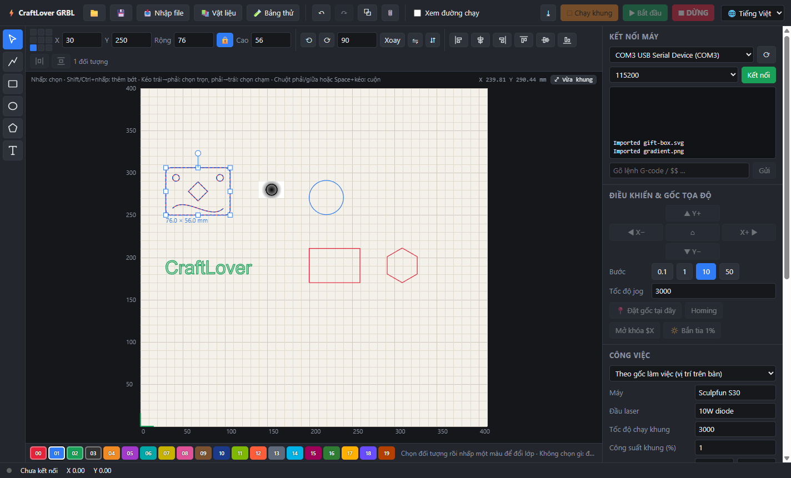
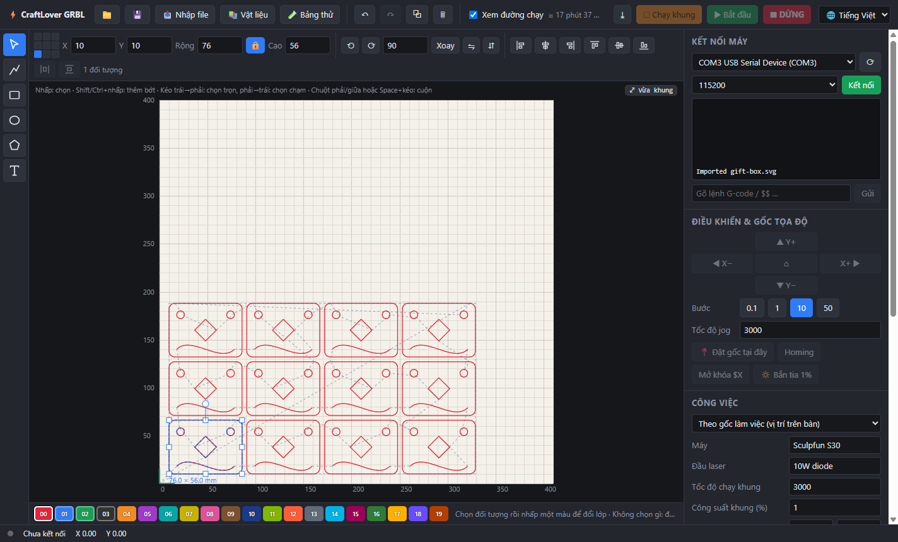

# CraftLover GRBL

[English](README.md) · **Tiếng Việt**

[](LICENSE)


CraftLover GRBL là phần mềm **mã nguồn mở, miễn phí** để thiết kế và điều khiển máy khắc/cắt laser chạy firmware **GRBL 1.1**.
Bạn có thể vẽ hoặc nhập file, sắp xếp nhiều sản phẩm trên bàn, chạy khung căn phôi rồi gửi lệnh cắt/khắc, tất cả trong một chương trình.
Phần mềm được cấu hình sẵn cho **Sculpfun S30 10W** và dùng được với hầu hết máy laser diode chạy GRBL.

> **Ngôn ngữ giao diện:** mặc định là tiếng Anh. Để chuyển sang tiếng Việt, chọn **🌐 Tiếng Việt** ở góc trên bên phải. Phần mềm nhớ lựa chọn này cho các lần mở sau.



---

## Mục lục

- [Tính năng](#tính-năng)
- [Cài đặt](#cài-đặt)
- [Bắt đầu nhanh](#bắt-đầu-nhanh)
- [Hướng dẫn sử dụng](#hướng-dẫn-sử-dụng)
- [Phím tắt](#phím-tắt)
- [Thông số gợi ý cho Sculpfun S30 10W](#thông-số-gợi-ý-cho-sculpfun-s30-10w)
- [An toàn](#an-toàn)
- [Xử lý sự cố](#xử-lý-sự-cố)
- [Dịch sang ngôn ngữ khác](#dịch-sang-ngôn-ngữ-khác)
- [Dành cho nhà phát triển](#dành-cho-nhà-phát-triển)
- [Lộ trình](#lộ-trình)
- [Giấy phép](#giấy-phép)

---

## Tính năng

**Thiết kế ngay trong phần mềm**
- Vẽ đường gấp khúc, hình chữ nhật (bo góc được), elip/hình tròn, đa giác đều, và chữ bằng font cài trên Windows (có dấu tiếng Việt).
- Chọn nhiều đối tượng, kéo vùng để chọn. Co giãn, xoay, lật đối tượng; căn lề và chia đều khoảng cách.
- Hoàn tác / làm lại, sao chép / dán, nhân đôi.
- Bảng màu: mỗi màu là một lớp gia công với tốc độ và công suất riêng.

**Nhập file**
- Vector: SVG, PDF, AI, EPS (EPS cần Ghostscript).
- Ảnh: JPG, PNG, BMP, GIF, WEBP.
- Dò viền ảnh để biến hình đen trắng thành đường cắt.

**Gia công**
- 3 chế độ lớp:
  - **Cắt / vạch nét:** chạy theo đường viền.
  - **Khắc tô kín:** tô kín vùng bên trong hình vector.
  - **Khắc ảnh:** chấm Floyd–Steinberg, đen trắng theo ngưỡng, hoặc thang xám.
- **Nhân bản theo lưới** để cắt nhiều sản phẩm trong một lần.
- Tự tối ưu thứ tự cắt: cắt chi tiết bên trong trước đường bao ngoài, và chọn đường gần nhất để giảm quãng chạy không.
- Xem trước đường chạy và thời gian ước tính. Xuất được file G-code.

**Điều khiển máy**
- Kết nối qua cổng USB (COM), xem trạng thái và vị trí của máy theo thời gian thực.
- Di chuyển đầu laser (jog), đặt gốc tọa độ, Homing, mở khóa, bắn tia 1% để căn.
- **Chạy khung** quanh vùng cắt với công suất rất thấp, để xem trước vị trí mà không làm cháy phôi.
- Chạy theo gốc làm việc, hoặc từ vị trí hiện tại của đầu laser với 9 điểm neo.
- Tạm dừng, tiếp tục, và nút **DỪNG** khẩn cấp (tắt laser ngay).

**Ngôn ngữ:** tiếng Anh (mặc định) và tiếng Việt, chuyển được bất cứ lúc nào.



---

## Cài đặt

Hiện chưa có bộ cài `.exe` đóng gói sẵn. Bạn chạy phần mềm từ mã nguồn theo các bước dưới đây, khoảng 5 phút.

### Yêu cầu

| Thành phần | Ghi chú |
|---|---|
| Windows 10 / 11 (64-bit) | Phần mềm đọc font và tìm Ghostscript theo kiểu Windows. Có thể chạy trên macOS/Linux nhưng chưa được thử. |
| [Node.js](https://nodejs.org/) 20 trở lên | Chọn bản LTS. |
| [Git](https://git-scm.com/downloads) | Để tải mã nguồn. |
| Driver USB-Serial (CH340) | Chỉ cần nếu Windows không nhận ra máy laser. |
| [Ghostscript](https://ghostscript.com/releases/gsdnld.html) 64-bit | *Không bắt buộc*. Chỉ cần nếu bạn muốn mở file EPS. |

### Các bước

Mở PowerShell và chạy lần lượt:

```powershell
git clone https://github.com/craft-lover-lab/craftlover-grbl.git
```

```powershell
cd craftlover-grbl
```

```powershell
npm install
```

```powershell
npm start
```

Những lần sau, chỉ cần mở thư mục `craftlover-grbl` và chạy `npm start`.
Khi muốn cập nhật bản mới, chạy `git pull` rồi `npm install`.

---

## Bắt đầu nhanh

Ví dụ dưới đây cắt một hình từ file SVG trên Sculpfun S30. Các tên nút được ghi theo giao diện tiếng Việt.

1. **Kết nối:** cắm cáp USB và bật nguồn máy. Ở bảng *Kết nối máy*, chọn cổng COM, chọn tốc độ **115200**, bấm **Kết nối**. Thanh trạng thái phía dưới sẽ hiện `Idle`.
2. **Kiểm tra máy** (chỉ cần làm lần đầu): gõ `$$` vào ô lệnh rồi bấm **Gửi**. Đảm bảo có hai dòng sau:
   - `$32=1`: chế độ laser, **bắt buộc**. Nếu đang khác 1, gõ `$32=1` để đặt.
   - `$30=1000`: phải khớp với ô *S max* trong bảng *Công việc*.
3. **Đặt gốc:** dùng các nút mũi tên để đưa đầu laser tới góc dưới-trái của phôi, rồi bấm **📍 Đặt gốc tại đây**.
4. **Nhập hoặc vẽ:** bấm **📥 Nhập file** để chọn file SVG, hoặc vẽ trực tiếp bằng các công cụ ở cạnh trái. Kéo đối tượng tới vị trí mong muốn.
5. **Chỉnh lớp:** mở lớp *Cắt* trong bảng *Lớp gia công*, nhập tốc độ, công suất và số lượt (xem [thông số gợi ý](#thông-số-gợi-ý-cho-sculpfun-s30-10w)).
6. **Chạy khung:** bấm **⬚ Chạy khung**. Đầu laser chạy một vòng quanh vùng cắt với tia rất yếu, để bạn xem phôi đã nằm đúng chỗ chưa.
7. **Chạy:** đeo kính bảo hộ, đóng nắp che (nếu có), rồi bấm **▶ Bắt đầu**.

---

## Hướng dẫn sử dụng

### Bố cục màn hình

| Khu vực | Chức năng |
|---|---|
| Thanh trên cùng | Mở/lưu dự án, nhập file, hoàn tác/làm lại, xem trước đường chạy, xuất G-code, chạy khung, bắt đầu, tạm dừng, dừng, chọn ngôn ngữ. |
| Cạnh trái | Công cụ vẽ: chọn, bút, chữ nhật, elip, đa giác, chữ. |
| Thanh thuộc tính | Điểm tham chiếu, X/Y, rộng/cao, xoay, lật, căn chỉnh. |
| Vùng làm việc | Bàn máy với lưới 10 mm. Gốc tọa độ (0,0) là góc dưới-trái, đánh dấu màu xanh lá. |
| Bảng màu (phía dưới) | Gán đối tượng vào lớp theo màu. |
| Cột phải | Kết nối, điều khiển máy, cài đặt công việc, thuộc tính đối tượng, lớp gia công. |

### Kết nối và điều khiển máy

- **Console:** hiển thị phản hồi của máy. Dòng `error` và `ALARM` có màu đỏ, kèm giải thích cho các mã báo động thường gặp.
- **Di chuyển đầu laser:** chọn bước di chuyển (0,1 / 1 / 10 / 50 mm) và tốc độ, rồi bấm các nút mũi tên. Nút ⌂ đưa đầu laser về gốc làm việc.
- **📍 Đặt gốc tại đây:** lấy vị trí hiện tại của đầu laser làm (0,0) (lệnh `G10 L20 P1 X0 Y0`).
- **Homing:** chạy về công tắc hành trình. Chỉ dùng được nếu máy có lắp công tắc.
- **Mở khóa $X:** mở khóa máy sau khi bị báo động.
- **🔆 Bắn tia 1%:** bật tia rất yếu để nhìn điểm laser khi căn chỉnh. **Đừng để tia đứng yên một chỗ lâu.**

### Gốc tọa độ và cách chạy

Chọn trong bảng *Công việc*:

- **Theo gốc làm việc:** đối tượng ở đâu trên màn hình thì máy cắt đúng chỗ đó, tính từ gốc bạn đã đặt. Phù hợp khi đặt phôi cố định trên bàn.
- **Từ vị trí đầu laser hiện tại:** công việc được đặt quanh vị trí hiện tại của đầu laser, theo 1 trong 9 điểm neo (ví dụ: tâm, góc dưới-trái). Trên màn hình sẽ hiện khung cam là vùng máy sẽ chạy. Phù hợp khi khắc lên một món đồ đặt tùy ý.

### Nhập file

| Định dạng | Kết quả |
|---|---|
| SVG | Đường vector (path, rect, circle, ellipse, line, polyline, polygon), giữ đúng kích thước mm/in/pt/px. Chữ trong SVG phải được chuyển thành đường cong trước (*Object to Path*). |
| PDF / AI | Đường vector để cắt. Nếu trang có chữ chưa chuyển thành đường cong hoặc có hình ảnh, phần mềm nhập thêm một bản ảnh để khắc. |
| EPS | Được chuyển sang PDF bằng Ghostscript, sau đó xử lý như PDF. |
| JPG, PNG, BMP, GIF, WEBP | Ảnh để khắc. Mặc định 10 điểm/mm, tự thu nhỏ nếu ảnh lớn hơn 150 mm. |

**Dò viền ảnh:** chọn một ảnh, chỉnh *Ngưỡng* và *Làm mượt* trong bảng *Đối tượng*, rồi bấm **✎ Dò viền**. Phần mềm tạo một đối tượng vector mới để cắt, nằm chồng lên ảnh gốc.

### Thiết kế trực tiếp

| Công cụ | Cách dùng |
|---|---|
| **Chọn** (V) | Nhấp để chọn; Shift/Ctrl + nhấp để thêm hoặc bớt. Kéo nền **từ trái sang phải** để chọn các đối tượng nằm *trọn* trong vùng; kéo **từ phải sang trái** để chọn mọi đối tượng *chạm* vào vùng. |
| **Bút** (L) | Nhấp để thêm điểm. Nhấp đúp hoặc Enter để kết thúc; nhấp lại điểm đầu để khép kín. Shift: góc 15°. Backspace: xóa điểm cuối. |
| **Hình chữ nhật** (R) | Kéo để vẽ. Shift: hình vuông; Ctrl: vẽ từ tâm. Chỉnh bo góc trong bảng *Đối tượng*. |
| **Elip** (E) | Kéo để vẽ. Shift: hình tròn; Ctrl: vẽ từ tâm. |
| **Đa giác** (P) | Kéo từ tâm ra. Số cạnh chỉnh ở thanh công cụ hoặc trong bảng *Đối tượng*. |
| **Chữ** (T) | Nhấp vào vị trí muốn đặt chữ, rồi chọn font, cỡ chữ (mm), căn lề và lớp. |

- Khi vẽ hoặc di chuyển, điểm tự bắt vào lưới 0,5 mm. Giữ **Alt** để tắt.
- **Tay nắm:**
  - 8 ô vuông quanh vùng chọn để co giãn. Ở góc thì giữ tỉ lệ; giữ Shift để kéo giãn tự do.
  - Chấm tròn phía trên để xoay. Giữ Shift để xoay từng bước 15°.
- **Thanh thuộc tính:** chọn điểm tham chiếu trong ô 9 chấm, rồi nhập X/Y/rộng/cao chính xác. Bấm 🔒 để giữ tỉ lệ.
- **Căn chỉnh:** khi chọn nhiều đối tượng, các nút căn theo khung chọn. Khi chọn 1 đối tượng, các nút căn theo bàn máy, ví dụ đặt vào giữa bàn.

### Lớp gia công và bảng màu

Mỗi lớp có màu riêng và các thông số sau:

| Thông số | Ý nghĩa |
|---|---|
| Chế độ | *Cắt/vạch theo nét*, *Khắc tô kín vector*, hoặc *Khắc ảnh*. |
| Tốc độ (mm/phút) | Càng chậm thì càng cháy sâu. |
| Công suất (%) | Phần trăm của S max. |
| Số lượt | Số lần chạy lặp lại. Cắt vật liệu dày nên chạy nhiều lượt. |
| Khoảng dòng (mm) | Khoảng cách giữa các đường quét khi khắc. 0,1 mm là phổ biến. |
| Đi quá biên (mm) | Đầu laser chạy vượt ra ngoài mỗi đường quét một đoạn, để tốc độ đều ở mép hình. |
| Quét 2 chiều | Khắc cả chiều đi lẫn chiều về, nhanh gấp đôi. |
| Xử lý ảnh | Floyd–Steinberg (chấm, đẹp cho ảnh chụp), Đen trắng (ngưỡng), Thang xám (đổi công suất theo độ đậm). |

- **Đổi lớp:** chọn đối tượng rồi nhấp một màu ở bảng màu phía dưới. Nếu màu đó chưa có lớp, phần mềm tự tạo lớp mới.
- **Màu cho hình vẽ mới:** không chọn gì rồi nhấp một màu.
- **Bỏ qua một lớp khi chạy:** bỏ tích ô vuông trước tên lớp.
- **Thứ tự chạy:** khắc ảnh → khắc tô → cắt. Cắt luôn chạy sau cùng để phôi không bị xê dịch khi đang khắc.
- **Tên lớp mặc định** (Cắt, Khắc nét, Khắc tô, Khắc ảnh) tự đổi theo ngôn ngữ giao diện. Tên bạn tự đặt thì giữ nguyên.

### Cắt nhiều sản phẩm một lần

Chọn đối tượng, rồi trong mục *Nhân bản* của bảng *Đối tượng*, nhập số **Cột**, số **Hàng** và khoảng cách giữa các bản sao.
Tất cả bản sao được cắt trong cùng một lệnh, và thứ tự cắt được tối ưu chung cho cả lô.

### Chạy khung, chạy lệnh, xuất file

- **⬚ Chạy khung:** đầu laser chạy một hình chữ nhật bao quanh toàn bộ vùng cắt. Đặt *Công suất khung* là 1% (mặc định) để thấy điểm sáng mà không cháy phôi, hoặc 0% để chỉ di chuyển mà không bật tia.
- **Xem đường chạy:** đường cắt hiện màu đỏ, quãng chạy không hiện nét đứt xanh, kèm thời gian ước tính.
- **▶ Bắt đầu / ⏸ Tạm dừng / ⏵ Tiếp tục:** tiến độ hiện ở thanh trạng thái phía dưới.
- **■ DỪNG:** gửi lệnh reset mềm (Ctrl-X). Máy dừng và tắt laser ngay lập tức.
- **⤓ Xuất G-code:** lưu file `.gcode` để chạy bằng phần mềm khác hoặc thẻ nhớ.
- **💾 Lưu dự án / 📁 Mở:** file `.lzr` lưu toàn bộ đối tượng (kể cả ảnh) và các lớp.

---

## Phím tắt

| Phím | Chức năng |
|---|---|
| V · L · R · E · P · T | Chọn · Bút · Chữ nhật · Elip · Đa giác · Chữ |
| Ctrl+Z / Ctrl+Y (hoặc Ctrl+Shift+Z) | Hoàn tác / Làm lại |
| Ctrl+C / Ctrl+X / Ctrl+V | Sao chép / Cắt / Dán |
| Ctrl+D | Nhân đôi |
| Ctrl+A | Chọn tất cả |
| Delete | Xóa |
| Mũi tên (Shift + mũi tên) | Dịch 1 mm (10 mm) |
| Esc | Về công cụ Chọn, bỏ chọn |
| Lăn chuột | Phóng to / thu nhỏ tại vị trí con trỏ |
| Space + kéo, hoặc kéo chuột phải/giữa | Cuộn vùng làm việc |
| Alt (khi kéo/vẽ) | Tắt bắt dính lưới |

---

## Thông số gợi ý cho Sculpfun S30 10W

> ⚠️ Đây chỉ là **điểm bắt đầu**. Gỗ, keo dán và độ ẩm khác nhau thì kết quả khác nhau.
> Luôn cắt thử trên một miếng vụn trước, và nhớ lấy nét đúng cho đầu laser.

| Công việc | Chế độ | Tốc độ (mm/phút) | Công suất | Lượt |
|---|---|---|---|---|
| Cắt ván ép / MDF 3 mm | Cắt | 300–400 | 100% | 1 |
| Cắt ván ép 5 mm | Cắt | 250–300 | 100% | 2–3 |
| Cắt bìa carton 2 mm | Cắt | 1000–1500 | 80% | 1 |
| Vạch nét trên gỗ | Cắt (vạch nét) | 3000 | 25–35% | 1 |
| Khắc tô chữ trên gỗ | Khắc tô kín | 4000–6000 | 30–45% | 1 |
| Khắc ảnh trên gỗ | Khắc ảnh (Floyd–Steinberg) | 3000 | 40–60% | 1 |

---

## An toàn

- Luôn đeo **kính bảo hộ đúng bước sóng 450 nm** khi máy đang chạy hoặc khi bắn tia.
- **Không bao giờ để máy chạy mà không có người trông.** Gỗ và giấy có thể bắt lửa. Hãy để sẵn bình chữa cháy nhỏ gần máy.
- Thông gió tốt, nên có quạt hút khói.
- Không cắt PVC, da nhân tạo hoặc nhựa có chứa clo: khói của chúng độc và ăn mòn máy.
- Khi có sự cố, bấm **■ DỪNG** rồi tắt nguồn máy.

---

## Xử lý sự cố

| Hiện tượng | Cách xử lý |
|---|---|
| Không thấy cổng COM | Kiểm tra cáp USB (nên dùng cáp có truyền dữ liệu), cài driver CH340, rồi bấm ⟳ để quét lại. Đóng các phần mềm khác đang chiếm cổng (LightBurn, LaserGRBL). |
| Kết nối được nhưng không thấy phản hồi | Thử tốc độ 115200. Rút cáp ra cắm lại, rồi bấm Kết nối lại. |
| Máy báo `ALARM` | Đọc giải thích trong console. Bấm **Mở khóa $X**, hoặc chạy **Homing** nếu máy có công tắc hành trình. |
| Laser không bật khi cắt | Kiểm tra `$32=1`, và kiểm tra ô S max có khớp `$30` không. |
| Laser vẫn sáng khi di chuyển không cắt | Chưa bật chế độ laser: đặt `$32=1`. |
| Khắc ảnh bị giật, dừng từng đoạn | Giảm tốc độ (khoảng 3000 mm/phút) hoặc tăng khoảng dòng. |
| Mở EPS báo lỗi Ghostscript | Cài Ghostscript bản 64-bit rồi mở lại phần mềm. |
| Chữ trong PDF không cắt được | Trong phần mềm thiết kế (Illustrator, CorelDRAW, Inkscape), chuyển chữ thành đường cong (*Create Outlines* / *Object to Path*) rồi xuất lại. |
| Vị trí cắt lệch so với khung | Đặt lại gốc trước khi chạy, kiểm tra chế độ gốc tọa độ đang dùng, và kiểm tra dây curoa có bị trượt không. |

---

## Dịch sang ngôn ngữ khác

Toàn bộ chữ trên giao diện nằm trong thư mục `src/renderer/src/i18n/`. Để thêm một ngôn ngữ:

1. Sao chép `vi.ts` thành `<mã-ngôn-ngữ>.ts` (ví dụ `fr.ts`) rồi dịch từng giá trị. Nếu bạn bỏ sót khóa nào, TypeScript sẽ báo.
2. Đăng ký file đó trong `DICTS` và `LANGS` ở `src/renderer/src/i18n/index.ts`.
3. Thêm nhãn cho hộp thoại mở/lưu file vào `DIALOG_TEXT` trong `src/main/main.ts`.

Rất hoan nghênh các Pull Request bổ sung ngôn ngữ mới.

---

## Dành cho nhà phát triển

Công nghệ: Electron · TypeScript · React · Vite · serialport · pdf.js · opentype.js.

```
src/
├── main/                 Tiến trình chính của Electron
│   ├── grbl.ts           Kết nối GRBL, gửi lệnh theo bộ đệm 127 byte
│   ├── system.ts         Ghostscript (EPS), danh sách font Windows
│   ├── main.ts           Cửa sổ, IPC, chế độ chụp màn hình tự động
│   └── preload.ts
└── renderer/src/
    ├── core/             Hình học, sinh G-code, khắc raster, dò viền, hình vẽ
    ├── io/               Đọc SVG, PDF vector, ảnh, chữ, dự án .lzr
    ├── i18n/             Bản dịch (en, vi)
    ├── machine/          Trạng thái máy (useGrbl)
    └── ui/               Giao diện: vùng làm việc, thanh công cụ, bảng điều khiển
```

| Lệnh | Mô tả |
|---|---|
| `npm start` | Build rồi mở ứng dụng |
| `npm run dev` | Chế độ phát triển, tự tải lại giao diện khi sửa code |
| `npm run typecheck` | Kiểm tra kiểu TypeScript |
| `npm run build` | Build tiến trình chính và giao diện vào thư mục `dist/` |

**Kiểm thử tự động bằng ảnh chụp:** ứng dụng tự nạp file, chạy các thao tác, chụp màn hình rồi thoát.

```bash
LASER_PROFILE=./tmp-profile \
LASER_SNAPSHOT=shot.png \
LASER_DEMO="samples/gift-box.svg;samples/gradient.png" \
LASER_ACTIONS='[["lang","vi"],["tool","rect"],["mouse",[["mousedown",50,50],["mouseup",100,80]]],["list"]]' \
LASER_GCODE_OUT=job.gcode \
npx electron .
```

`LASER_PROFILE` cho ứng dụng dùng một thư mục cài đặt riêng, để mỗi lần chạy giống như vừa cài mới.
Thư mục `samples/` có các file mẫu để thử.

Mọi đóng góp đều được chào đón: hãy mở *Issue* để báo lỗi hoặc đề xuất tính năng, hoặc gửi *Pull Request*.

---

## Lộ trình

- [ ] Bộ cài `.exe` cho Windows
- [ ] Sửa từng điểm nút của đường, ghép/cắt hình (boolean), nhóm đối tượng
- [ ] Mô phỏng quá trình cắt theo thời gian
- [ ] Tự tách lớp theo màu nét trong file SVG
- [ ] Camera căn phôi, khắc vật tròn (rotary)
- [ ] Thêm các ngôn ngữ giao diện khác

---

## Giấy phép

Phát hành theo giấy phép [MIT](LICENSE). Bạn được tự do sử dụng, sửa đổi và phân phối lại, kể cả cho mục đích thương mại.

Các thư viện bên thứ ba giữ giấy phép riêng của chúng:

| Thư viện | Giấy phép |
|---|---|
| Electron, React, serialport, opentype.js | MIT |
| pdf.js | Apache-2.0 |

Ghostscript (AGPL) **không** được đóng gói kèm. Phần mềm chỉ gọi Ghostscript nếu người dùng đã tự cài trên máy.
